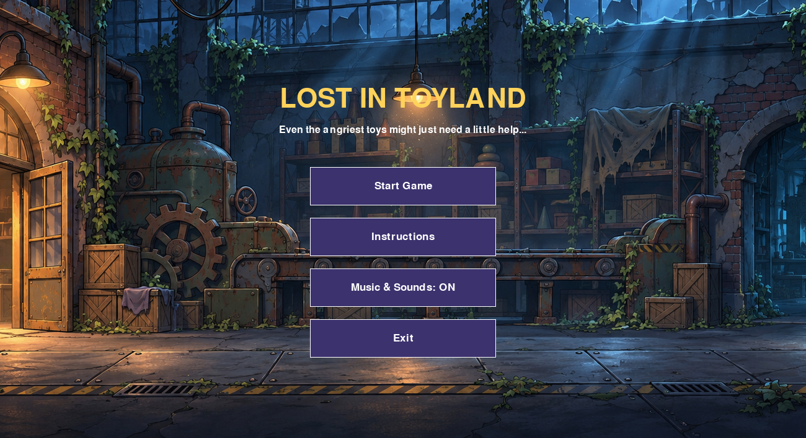
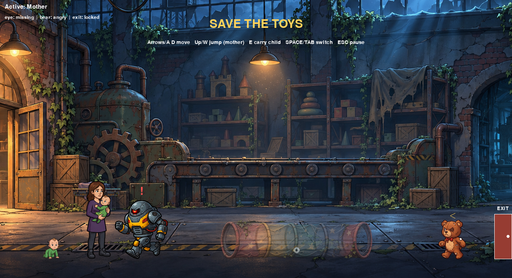
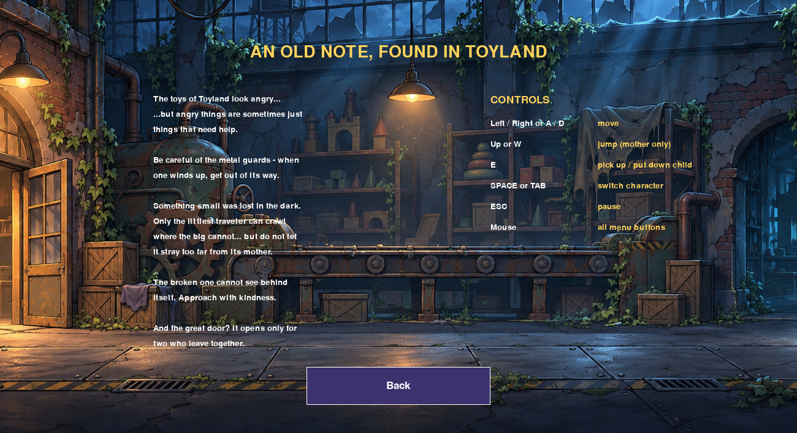

# Lost in Toyland

A side-view platformer written in Python with **Pygame Zero** for the
Kodland Python DST.



Even the angriest toys might just need a little help... A mother and
her child are lost in an abandoned Toyland. Dodge the wind-up robot,
crawl through the tunnel to find what was lost, sneak up on the broken
bear, and escape together.



## How to run

```bash
pip install pgzero
pgzrun game.py
```

## Controls

| Key | Action |
| --- | --- |
| Left / Right (or A / D) | Move the active character |
| Up / W | Jump (**only the mother can jump**) |
| E | Pick up / put down the child (control passes to it when dropped) |
| SPACE or TAB | Switch between mother and child |
| ESC | Pause / resume |
| Mouse | All menu buttons |

Everything happens automatically: the baby picks up the bear's eye by
walking into it, the bear is saved when someone carrying the eye
stands right behind it while it is calm, and mother and child escape
as soon as they both reach the open exit.

## Game rules

- The baby cannot jump, but it crawls **through the tunnel** (only it
  fits) where the bear's missing eye hides.
- The baby cannot wander far from its mother - it stops and calls
  "Mommy!" at the limit.
- The robot patrols the corridor and **charges** when it spots you -
  jump over it when it winds up.
- The broken bear attacks anything it can see; approach from its
  **blind side** to save it.
- Touching the robot or being caught by the angry bear means game
  over. The exit stays locked until the bear is saved.



## Menu

- **Start Game** - begins a new level
- **Instructions** - the old note found in Toyland (goal + controls)
- **Music & Sounds: ON/OFF** - mutes/unmutes the theme and all sound
  effects (kept between games)
- **Exit** - closes the game

## Tech notes

- Only Pygame Zero + `math` are used (no other imports)
- OOP design: `Animation`, `Character` (Mother/Child), `Enemy`
  (Robot/Bear) classes
- Version-proof sprite rendering (explicit foot-anchored drawing),
  fixed-size collision hitboxes, fixed-timestep physics
- Original artwork, animation frames, music and sound effects by the
  project author; starter-pack assets (`background.png`,
  `sounds/eep.wav`) from the Kodland course

Full details, asset attribution and design decisions: see
[`readme.txt`](readme.txt).
